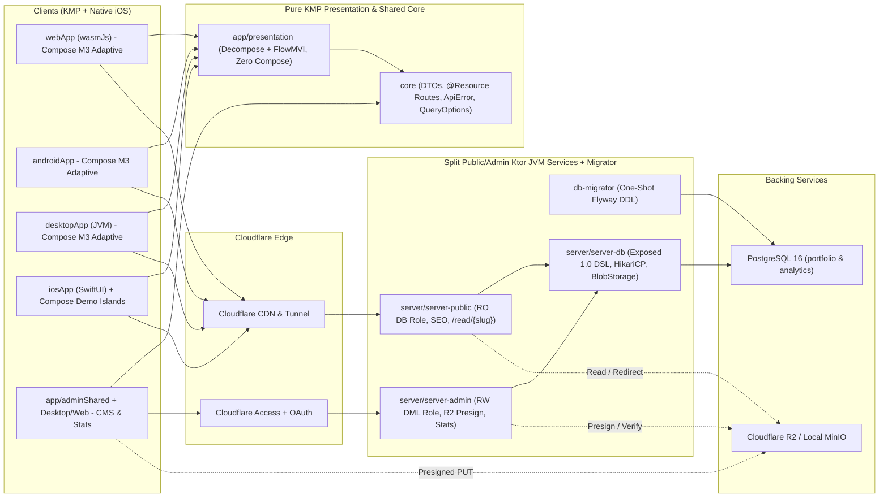

This is a Kotlin Multiplatform project targeting Android, Desktop (JVM), iOS, Web, Server, built with
the [Kotlin Toolchain](https://kotlin-toolchain.org/dev/).

- [/app/androidApp](./app/androidApp) contains the Android application.
- [/app/desktopApp](./app/desktopApp) contains the desktop (JVM) application.
- [/app/iosApp](./app/iosApp) contains the iOS application (native SwiftUI + embedded Compose demo islands).
- [/app/presentation](./app/presentation) holds pure KMP presentation, Decompose navigation, and FlowMVI logic (zero Compose imports).
- [/app/composeUi](./app/composeUi) holds the shared Compose Multiplatform adaptive UI, Markdown/Highlights renderer, and interactive demo registry.
- [/app/webApp](./app/webApp) contains the public web application, compiled to WebAssembly with Kotlin/Wasm (`wasmJs`).
- [/app/adminShared](./app/adminShared), [/app/adminDesktopApp](./app/adminDesktopApp), and [/app/adminWebApp](./app/adminWebApp) contain the dedicated Admin CMS and analytics UI.
- [/core](./core) holds shared `@Serializable` DTOs, Ktor `@Resource` contracts, `ApiError`, `QueryOptions`, and `PortfolioJson`.
- [/server/server-db](./server/server-db), [/server/server-public](./server/server-public), and [/server/server-admin](./server/server-admin) contain the compile-time split public/admin Ktor JVM backend and PostgreSQL/Flyway data layer.

The `kotlin` (macOS/Linux) and `kotlin.bat` (Windows) scripts in the project root are self-bootstrapping wrappers for
the Kotlin Toolchain: they download the pinned toolchain version on first use, so no separate installation is required.
Build the whole project with `./kotlin build`.

### Running

Use the run configurations provided by the run widget in your IDE's toolbar. You can also run each module from the
command line:

- Android app: `./kotlin run -m androidApp`
- Desktop app: `./kotlin run -m desktopApp`
- iOS app: `./kotlin run -m iosApp`
- Web app: `./kotlin run -m webApp`
- Admin desktop app: `./kotlin run -m adminDesktopApp`
- Admin web app: `./kotlin run -m adminWebApp`
- Public server: `./kotlin run -m server-public`
- Admin server: `./kotlin run -m server-admin`

### Testing

Run the project's tests with `./kotlin test`, or `./kotlin test -m <module>` for a single module.

---

### Documentation & Architecture

- [Coding Standards](./CODING_STANDARDS.md) — Universal pillars, Kotlin/KMP/SwiftUI/Ktor/PostgreSQL rules, Docker, and Bruno standards.
- [Master Architecture Plan & Phase Tracker](docs/01_PLAN.md) — Living phased roadmap (`Phase 1`–`Phase 6`), API contracts, ERD, and sequence diagrams.
- [Architecture Decision Records (ADRs)](./docs/architecture-decisions.md) — Recorded rationale and trade-offs (`ADR 1`–`ADR 10`).
- [Reusable Libraries & Template Extraction Plan](docs/LIBS_PLAN.md) — Reusable KMP/Ktor/SwiftUI libraries vs. full-stack starter template blueprint.

### Target Architecture Overview

---

Learn more
about [Kotlin Multiplatform](https://www.jetbrains.com/help/kotlin-multiplatform-dev/get-started.html), [Kotlin Toolchain](https://kotlin-toolchain.org/dev/), [Compose Multiplatform](https://kotlinlang.org/compose-multiplatform/), [Kotlin/Wasm](https://kotl.in/wasm/), [Ktor](https://ktor.io/).
