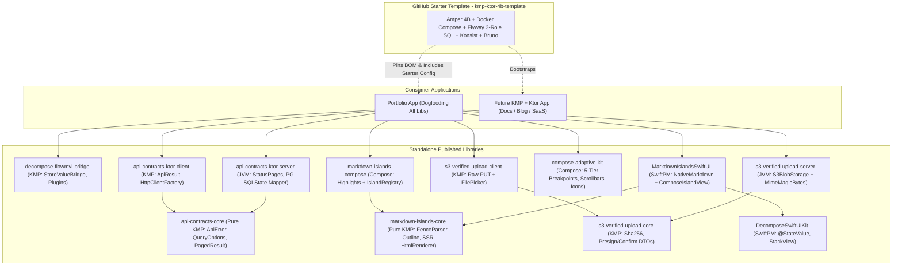

# Portfolio — Reusable Libraries & Project Template Extraction Plan

> **Purpose:** Identify which subsystems built in the **Portfolio** monorepo should be extracted into **standalone, versioned libraries** (KMP / Compose Multiplatform / Ktor / SwiftPM), which belong in a **project starter template / archetype**, and which are strictly **domain-specific** to Portfolio. Includes clean decoupled API proposals, a target dependency topology, packaging strategy, and a phased extraction roadmap.

---

## 1. Executive Summary & Classification Rubric

Not every piece of reusable infrastructure benefits equally from binary library distribution. Extracting fast-changing project scaffolding into a compiled library creates brittle upgrade coupling, whereas copying pure algorithms or UI bridges between repositories duplicates bug fixes across projects.

### Classification Criteria

| Form | Extract When... | Avoid Extracting When... |
| :--- | :--- | :--- |
| **Standalone Versioned Library** (`.klib` / `.jar` / SwiftPM) | Logic is **domain-agnostic**, has a **small stable surface**, runs on clear interfaces/generics, and benefits from centralized bug fixes across multiple apps (parsers, wire contracts, lifecycle bridges, adaptive shells). | Configuration constantly diverges per repo, requires inline SQL/YAML editing, or couples tightly to one business schema. |
| **GitHub Starter Template / Copier Archetype** | Value lies in **structural conventions, Docker/SQL plumbing, security baselines, and CI/QA harnesses** that teams inspect and customize at project bootstrap. | Pure logic that doesn't change per business domain (e.g., SHA-256, `ApiError` codec, Markdown fence splitting). |
| **Keep App-Local** | Coupled directly to Portfolio's domain entities (`WriteupDto`, `ExperienceDto`, `portfolio.*` tables) or one-off UI views. | — |

### Subsystem Decision Matrix

| Subsystem | Current Source Files | Recommendation | Proposed Name | Effort | Payoff |
| :--- | :--- | :--- | :--- | :--- | :--- |
| **Markdown + Code Highlighting + Interactive Demo Islands** | [MarkdownSegmentParser.kt](../app/composeUi/src/codes/cy/portfolio/ui/markdown/MarkdownSegmentParser.kt), [MarkdownOutlineExtractor.kt](../app/presentation/src/codes/cy/portfolio/presentation/features/readarticle/MarkdownOutlineExtractor.kt), [PortfolioMarkdownView.kt](../app/composeUi/src/codes/cy/portfolio/ui/markdown/PortfolioMarkdownView.kt), [DemoRegistry.kt](../app/composeUi/src/codes/cy/portfolio/ui/demos/DemoRegistry.kt), [MarkdownHtmlRenderer.kt](../server/server-public/src/codes/cy/portfolio/server/publicapi/domain/MarkdownHtmlRenderer.kt), [NativeMarkdownView.swift](../app/iosApp/src/Markdown/NativeMarkdownView.swift), [SwiftSyntaxHighlighter.swift](../app/iosApp/src/Markdown/SwiftSyntaxHighlighter.swift), [ComposeDemoIslandView.swift](../app/iosApp/src/Markdown/ComposeDemoIslandView.swift) | **Standalone Library** | `kmp-markdown-islands` (`-core`, `-compose`, `MarkdownIslandsSwiftUI`) | Low–Med | **Very High** |
| **Pure KMP `ApiError`, CWE-190 Pagination & Ktor Bridges** | [ApiError.kt](../core/src/codes/cy/portfolio/core/error/ApiError.kt), [QueryOptions.kt](../core/src/codes/cy/portfolio/core/pagination/QueryOptions.kt), [PagedResult.kt](../core/src/codes/cy/portfolio/core/pagination/PagedResult.kt), [IdentifierValidationExtensions.kt](../core/src/codes/cy/portfolio/core/validation/IdentifierValidationExtensions.kt), [ApiResult.kt](../app/presentation/src/codes/cy/portfolio/presentation/data/ApiResult.kt), [PortfolioHttpClientFactory.kt](../app/presentation/src/codes/cy/portfolio/presentation/data/PortfolioHttpClientFactory.kt), [DomainExceptions.kt](../server/server-db/src/codes/cy/portfolio/server/db/errors/DomainExceptions.kt), [ApiErrorMapping.kt](../server/server-db/src/codes/cy/portfolio/server/db/errors/ApiErrorMapping.kt), [ApiErrorExtensions.kt](../server/server-public/src/codes/cy/portfolio/server/publicapi/api/ApiErrorExtensions.kt), [QueryOptionsExtensions.kt](../server/server-public/src/codes/cy/portfolio/server/publicapi/api/QueryOptionsExtensions.kt) | **Standalone Library** | `kmp-api-contracts` (`-core`, `-ktor-client`, `-ktor-server`) | Low | **Very High** |
| **Decompose + FlowMVI + Essenty Single-Subscription Bridge & SwiftUI Wrappers** | [StoreValueBridge.kt](../app/presentation/src/codes/cy/portfolio/presentation/plugins/StoreValueBridge.kt), [PortfolioErrorPlugin.kt](../app/presentation/src/codes/cy/portfolio/presentation/plugins/PortfolioErrorPlugin.kt), [PortfolioLoggingPlugin.kt](../app/presentation/src/codes/cy/portfolio/presentation/plugins/PortfolioLoggingPlugin.kt), [main.kt](../app/webApp/src/main.kt), [DecomposeWrappers.swift](../app/iosApp/src/Decompose/DecomposeWrappers.swift) | **Standalone Library** | `kmp-decompose-flowmvi-kit` (`-bridge`, `DecomposeSwiftUIKit`) | Low | **High** |
| **5-Tier Material 3 Adaptive Shell, Modality, Scrollbars & Stroke Icons** | [AdaptiveLayoutSpec.kt](../app/composeUi/src/codes/cy/portfolio/ui/adaptive/AdaptiveLayoutSpec.kt), [PlatformModality.kt](../app/composeUi/src/codes/cy/portfolio/ui/adaptive/PlatformModality.kt), [CommonUi.kt](../app/composeUi/src/codes/cy/portfolio/ui/components/CommonUi.kt), [PortfolioIcons.kt](../app/composeUi/src/codes/cy/portfolio/ui/theme/PortfolioIcons.kt), plus Admin `PlatformFilePicker` & pure-Kotlin `Sha256` | **Standalone Library** | `compose-adaptive-editorial-kit` | Low–Med | **High** |
| **Direct-to-R2/S3 Presigned PUT + Magic-Byte MIME Uploader** | [BlobStorage.kt](../server/server-db/src/codes/cy/portfolio/server/db/storage/BlobStorage.kt), [S3BlobStorage.kt](../server/server-db/src/codes/cy/portfolio/server/db/storage/S3BlobStorage.kt), [MimeMagicBytes.kt](../server/server-db/src/codes/cy/portfolio/server/db/storage/MimeMagicBytes.kt), [DocumentDtos.kt](../core/src/codes/cy/portfolio/core/model/DocumentDtos.kt) (presign/confirm envelopes), plus KMP `Sha256` + presigned binary PUT | **Standalone Library** | `ktor-s3-verified-upload` (`-core`, `-server`, `-ktor-client`) | Medium | **Med–High** |
| **Admin Auth Plugin (`Cf-Access-Jwt-Assertion` + OAuth Allowlist + Dev JWT)** | [AdminAuthPlugin.kt](../server/server-admin/src/codes/cy/portfolio/server/admin/api/AdminAuthPlugin.kt), [AdminAuthenticator.kt](../server/server-admin/src/codes/cy/portfolio/server/admin/infrastructure/AdminAuthenticator.kt), [dev-token.sh](../scripts/dev-token.sh) | **Template First** (optional tiny Ktor lib later) | `kmp-ktor-4b-template` | Low | **High** |
| **4B Compile-Time Split, Docker/Compose, Flyway 3-Role SQL, Konsist & Bruno** | [project.yaml](../project.yaml), [compose.yaml](../compose.yaml), [CODING_STANDARDS.md](../CODING_STANDARDS.md), [ArchitectureFitnessTest.kt](../server/server-db/test/codes/cy/portfolio/server/db/ArchitectureFitnessTest.kt), [01_schema_structure_tests.sql](../server/server-db/db/tests/01_schema_structure_tests.sql), [smoke.sh](../scripts/smoke.sh) | **Starter Template** | `kmp-ktor-4b-template` | Low–Med | **Very High** |
| **Portfolio Domain Models, Routes, Exposed Tables & UI Screens** | `CareerDtos.kt`, `ProjectDtos.kt`, `WriteupDtos.kt`, `AnalyticsDtos.kt`, `PortfolioTables.kt`, `ProfileScreen.kt`, etc. | **Keep Local** | Portfolio app | — | — |

---

## 2. Target Ecosystem & Dependency Topology

Extracting into small, focused layers prevents heavy UI dependencies (Compose, Skiko) from leaking into pure KMP presentation modules, server binaries, or SwiftUI hosts.



---

## 3. Standalone Library Proposals

### Library 1 — `kmp-markdown-islands` (Highest Priority)

Your custom Markdown + interactive island pipeline is the clearest "crown jewel" candidate for extraction. Today it spans three rendering engines (**Compose Multiplatform**, **Native SwiftUI + UIKit islands**, and **Server-Side Ktor HTML Reader View**) while sharing one canonical directive syntax (` ```demo:<id> `).

#### Why Extract Now
- Eliminates maintaining fence-parsing and ToC-slug algorithms in two places ([MarkdownSegmentParser.kt](../app/composeUi/src/codes/cy/portfolio/ui/markdown/MarkdownSegmentParser.kt) and [MarkdownOutlineExtractor.kt](../app/presentation/src/codes/cy/portfolio/presentation/features/readarticle/MarkdownOutlineExtractor.kt)).
- Gives every future documentation hub, technical blog, release-notes viewer, or admin CMS instant live-widget embedding across Android, Desktop, `wasmJs`, iOS SwiftUI, and SEO HTML.

#### Artifacts & Public APIs
1. **`markdown-islands-core`** (`kmp/lib`: `jvm`, `android`, `ios*`, `wasmJs` — **zero Compose deps**):
   - Parameterize the prefix (default `"demo:"`, configurable e.g. `"island:"` or `setOf("demo:", "chart:")`):
     - `MarkdownFenceSegment` (`Prose(val markdown: String)` | `Island(val kind: String, val id: String, val rawBody: String, val metadata: Map<String, String>)`)
     - `MarkdownSegmentParser.parse(markdown: String, islandPrefixes: Set<String> = setOf("demo:")): List<MarkdownFenceSegment>`
   - Unified `MarkdownOutlineExtractor.extract(markdown: String, maxLevel: Int = 4): MarkdownOutline` returning `headings: List<TocHeading>` and `embeddedIslands: List<IslandRef>`.
   - `HtmlMarkdownRenderer(islandFallbackHtml: (IslandRef) -> String)`: generalized from [MarkdownHtmlRenderer.kt](../server/server-public/src/codes/cy/portfolio/server/publicapi/domain/MarkdownHtmlRenderer.kt) with XSS escaping, sanitized `http`/`https`/`/` `href` allowlist, and customizable `<aside>` fallback links for static `/read/{slug}` SEO views.
2. **`markdown-islands-compose`** (Compose Multiplatform):
   - Decouple from `PortfolioThemeDefaults` and hardcoded `DemoRegistry` by defining:
     ```kotlin
     fun interface IslandRenderer {
         @Composable
         fun Content(island: MarkdownFenceSegment.Island, modifier: Modifier)
     }

     class IslandRegistry(
         private val renderersById: Map<String, IslandRenderer>,
         val fallbackCard: @Composable (MarkdownFenceSegment.Island, Modifier) -> Unit = { ... },
     )
     ```
   - Export `InteractiveMarkdownView(markdown, registry, style: MarkdownThemeTokens, onUriClick: (String) -> Unit)` wrapping `multiplatform-markdown-renderer-m3`, `-code`, and `Highlights` (`SyntaxThemes.atom`).
3. **`MarkdownIslandsSwiftUI`** (SwiftPM):
   - Extract [NativeMarkdownView.swift](../app/iosApp/src/Markdown/NativeMarkdownView.swift), [SwiftSyntaxHighlighter.swift](../app/iosApp/src/Markdown/SwiftSyntaxHighlighter.swift), and [ComposeDemoIslandView.swift](../app/iosApp/src/Markdown/ComposeDemoIslandView.swift).
   - Inject an `islandProvider: (String, ColorScheme) -> AnyView` or `(String, Bool) -> UIViewController` + `recommendedHeight: (String) -> CGFloat` closure instead of calling the Portfolio-specific `IosPortfolioBridge.shared` singleton directly.

---

### Library 2 — `kmp-api-contracts` (Errors, CWE-190 Pagination & Ktor Bridge)

Your `//core` + Ktor Client + Exposed/PostgreSQL error/pagination stack has zero domain assumptions and prevents subtle bugs (CWE-190 integer overflow in SQL offsets, SQLState `23505`/`23503` leakage, and `expectSuccess = true` swallowing typed error payloads).

#### Artifacts & Public APIs
1. **`api-contracts-core`** (Pure KMP `jvm`, `android`, `ios*`, `wasmJs`):
   - `ApiError` sealed hierarchy + `FieldViolation` + `ApiError.httpStatusCode()` ([ApiError.kt](../core/src/codes/cy/portfolio/core/error/ApiError.kt)).
   - `QueryOptions` (safe `calculateOffsetOrNull()` CWE-190 guard), `PagedResult<T>`, and `SortDirection` ([QueryOptions.kt](../core/src/codes/cy/portfolio/core/pagination/QueryOptions.kt), [PagedResult.kt](../core/src/codes/cy/portfolio/core/pagination/PagedResult.kt)).
   - `ContractJson: Json` (explicit `encodeDefaults = true`, `ignoreUnknownKeys = true`, `explicitNulls = true`) and validation helpers (`isSafeSlug()`, `isSafeSqlIdentifier()`, `validateAllowedSortField(...)`).
2. **`api-contracts-ktor-client`** (Pure KMP Ktor Client):
   - `ApiResult<T>` (`Success` / `Failure(ApiError)`) with `map`, `fold`, `onSuccess`, `onFailure`, and `toDisplayMessage()` ([ApiResult.kt](../app/presentation/src/codes/cy/portfolio/presentation/data/ApiResult.kt)).
   - `KtorClientFactory.create(baseUrl, json, engine = null, configure = {})` (`expectSuccess = false`, `Resources`, `ContentNegotiation`) paired with multiplatform `CIO`/`Darwin`/`Js` actuals.
   - Generic `HttpClient.safeJsonCall<T>(...)` & `HttpResponse.toApiErrorFailure(json)` replacing duplicated try/catch + fallback status mapping across every client module (public + admin).
3. **`api-contracts-ktor-server`** (JVM):
   - Domain exceptions (`ValidationException`, `UnauthorizedException`, `ForbiddenException`, `NotFoundException`, `ConflictException`), PostgreSQL SQLState (`23505`, `23503`, `23514`, `22P02`) causal mapper ([ApiErrorMapping.kt](../server/server-db/src/codes/cy/portfolio/server/db/errors/ApiErrorMapping.kt)), `Application.installApiErrorStatusPages(isDevelopment, logger)`, `ApplicationCall.respondCreated(location, body)`, and `toValidatedQueryOptions(...)`.

---

### Library 3 — `kmp-decompose-flowmvi-kit` (Lifecycle Bridge & SwiftUI State Wrappers)

Phase 3 and Phase 5 uncovered two non-trivial integration invariants worth codifying once and never debugging again:
1. **Explicit `coroutineContext` & Single Subscription in FlowMVI + Essenty:** `flowmvi-essenty`'s default `Lifecycle.subscribe` ignores test `UnconfinedTestDispatcher` contexts, and registering two `.collect { }` calls against FlowMVI's default `ActionShareBehavior.Distribute()` splits actions between subscribers. [StoreValueBridge.kt](../app/presentation/src/codes/cy/portfolio/presentation/plugins/StoreValueBridge.kt) solves both with `lifecycle.repeatOnLifecycle(STARTED, context = coroutineContext)` + one `store.collect { coroutineScope { ... } }`.
2. **SwiftUI Observable Decompose Bridge:** [DecomposeWrappers.swift](../app/iosApp/src/Decompose/DecomposeWrappers.swift) provides `ObservableValue<T>`, `@StateValue`, and `StackView` (with required `import Combine` and main-thread dispatch) so any native SwiftUI app can bind cleanly to KMP Decompose `Value<T>` components.

#### Artifacts & Public APIs
- **`decompose-flowmvi-bridge`** (KMP `jvm`, `android`, `ios*`, `wasmJs`):
  - `Store<S, I, A>.asDecomposeValue(initialState, lifecycle, coroutineContext, onAction)`
  - `StoreBuilder.installSafeErrorRecovery(...)` (preserving `CancellationException`) and `StoreBuilder.installDebugLogging(...)`
  - `LifecycleRegistry.attachToBrowserVisibility()` (`wasmJs` helper from [app/webApp/src/main.kt](../app/webApp/src/main.kt))
- **`DecomposeSwiftUIKit`** (SwiftPM):
  - `ObservableValue`, `@StateValue`, `StackView`, and `PanelsContainer` wrapper helpers parameterized by Kotlin module export protocol.

---

### Library 4 — `compose-adaptive-editorial-kit` (5-Tier M3 Adaptive Shell & Lightweight Chrome)

Across public and admin apps, both share the exact same adaptive geometry rules, mouse/touch modality adaptation, JVM/WasmJS scrollbars, and custom vector icon builder (explicitly written to avoid bundling multi-megabyte Material Extended icon packs into `wasmJs` Wasm binaries).

#### Source Files to Generalize
- [AdaptiveLayoutSpec.kt](../app/composeUi/src/codes/cy/portfolio/ui/adaptive/AdaptiveLayoutSpec.kt) (`currentWindowAdaptiveInfoV2()` mapped to `COMPACT`, `MEDIUM`, `EXPANDED`, `LARGE`, `EXTRA_LARGE`, reading measure cap, grid column counts, `BOTTOM_BAR` / `NAVIGATION_RAIL` / `PERMANENT_DRAWER`, `ChildPanelsMode`).
- [PlatformModality.kt](../app/composeUi/src/codes/cy/portfolio/ui/adaptive/PlatformModality.kt) + JVM/`wasmJs`/Android/iOS actuals for `InputModality` (`POINTER`/`TOUCH`) and `PlatformVerticalScrollbar` / `PlatformLazyVerticalScrollbar`.
- [PortfolioIcons.kt](../app/composeUi/src/codes/cy/portfolio/ui/theme/PortfolioIcons.kt) (`strokeIcon` builder DSL + core navigation/action glyphs).
- [CommonUi.kt](../app/composeUi/src/codes/cy/portfolio/ui/components/CommonUi.kt) (`InteractiveSurfaceCard` with hover + pointer hand icon, `SectionHeader`, `MonoTagChip`, `LoadingStateView`, `ErrorStateView`, `EmptyStateView`).
- **From Phase 6 (`adminShared`):** Pure-Kotlin `Sha256` (`ByteArray.sha256Hex()`) and cross-platform `PlatformFilePicker` (`jvm` AWT `FileDialog` + `wasmJs` `<input type="file">`).

---

### Library 5 — `ktor-s3-verified-upload` (Direct-to-R2/S3 Presigned PUT + Magic-Byte Check)

Many KMP/Ktor backends need secure binary uploads without routing files through application memory or Postgres `BYTEA`. Your implementation establishes a battle-tested pattern:
1. Pure-Kotlin SHA-256 on client -> `POST /presign`
2. Isolated unauthenticated HTTP `PUT` straight to R2/MinIO (never leaking `Authorization` or Cloudflare Access headers to the storage bucket)
3. `POST /confirm` running S3 `HeadObject` + range read of leading `64` bytes against [MimeMagicBytes.kt](../server/server-db/src/codes/cy/portfolio/server/db/storage/MimeMagicBytes.kt), deleting mismatched objects immediately.
4. Separate `BlobStorageReader` (least-privilege RO interface for public download/redirect services) vs. `BlobStorage` (RW presignPut/verify/delete for admin services) in [BlobStorage.kt](../server/server-db/src/codes/cy/portfolio/server/db/storage/BlobStorage.kt) and dual-endpoint (`endpointUrl` vs. `publicEndpointUrl`) support in [S3BlobStorage.kt](../server/server-db/src/codes/cy/portfolio/server/db/storage/S3BlobStorage.kt) for Dockerized MinIO.

---

## 4. What Belongs in a Starter Template (`kmp-ktor-4b-template`)

The following assets lose flexibility if compiled into a binary dependency, and instead belong in a **GitHub Template Repository** (optionally parameterized with **Copier** or `init-project.sh` for package/service renaming):

1. **4B Module Topology (`project.yaml`, `libs.versions.toml`):**
   - Clean compile-time split (`core`, `server-db`, `server-public`, `server-admin`, `app/presentation`, `app/composeUi`, `app/iosApp`, `app/adminShared`).
2. **PostgreSQL 16 + Flyway + 3-Tier Least-Privilege SQL Baseline:**
   - Init script creating `<app>_migrator` (DDL only), `<app>_admin` (DML RW), `<app>_public` (RO + append-only events).
   - Reference [01_schema_structure_tests.sql](../server/server-db/db/tests/01_schema_structure_tests.sql) verifying zero naive `TIMESTAMP` columns, `GENERATED AS IDENTITY` / `UUID`, 100% FK B-Tree indexes, and role denial checks.
3. **Profiled Docker Compose, Non-Root Dockerfiles & Bash Harness:**
   - [compose.yaml](../compose.yaml) (`deps`, `local`, `test` profiles, `127.0.0.1` bindings, Flyway one-shot migrator, `pgsty/minio`).
   - Multi-stage Temurin 25 JDK -> Alpine JRE non-root `Dockerfile`s with `-XX:MaxRAMPercentage=75.0`.
   - `scripts/{lib.sh, up.sh, down.sh, dev-token.sh, smoke.sh}` with `set -euo pipefail` and `shfmt -i 4`.
4. **Architecture & API Fitness Harness:**
   - [CODING_STANDARDS.md](../CODING_STANDARDS.md), `.editorconfig`, `.githooks/pre-commit` (protecting merged `V*.sql` migrations).
   - Parameterized [ArchitectureFitnessTest.kt](../server/server-db/test/codes/cy/portfolio/server/db/ArchitectureFitnessTest.kt) (Konsist rules guarding Compose-free presentation, `var`-free `data class`es, and public/admin isolation) + Testcontainers Postgres/MinIO harness.
   - `bruno/` chronological smoke & negative-test suite skeleton.
5. **Admin Auth Scaffold (`AdminAuthPlugin`):**
   - Route-scoped Cloudflare Access RS256 JWKS verifier + OAuth allowlist HS256 + local `dev-token.sh` profile ([AdminAuthPlugin.kt](../server/server-admin/src/codes/cy/portfolio/server/admin/api/AdminAuthPlugin.kt), [AdminAuthenticator.kt](../server/server-admin/src/codes/cy/portfolio/server/admin/infrastructure/AdminAuthenticator.kt)). *Note:* Could graduate into a tiny `ktor-cloudflare-access-auth` library once reused by 2+ services, while keeping route/role conventions in the template.

---

## 5. Packaging, Coordinates & Versioning Strategy

1. **Repository Split:**
   - **`cy-kmp-kit` (Monorepo for Gradle/Maven KMP Libraries):** Group ID `codes.cy.kit`, managed via Gradle Version Catalog + Amper/Kotlin Toolchain compatibility metadata, publishing a BOM (`codes.cy.kit:kit-bom`).
   - **`cy-swiftui-kit` (Companion Swift Package Repository):** Single `Package.swift` exporting `DecomposeSwiftUIKit` and `MarkdownIslandsSwiftUI` (minimum iOS `17.0` / `18.0`), tagged cleanly with matching SemVer.
   - **`kmp-ktor-4b-template` (GitHub Template Repo):** Pins `cy-kmp-kit` BOM version in `libs.versions.toml` and focuses purely on project layout, SQL/Docker/Bruno plumbing, and CI workflows.
2. **Distribution Channels:**
   - **Stage A (Immediate Internal Reuse):** Publish KMP artifacts to **GitHub Packages** (`https://maven.pkg.github.com/cy/cy-kmp-kit`) and use Git-tag SwiftPM URLs. Zero ceremony, multi-repo consumption in Amper/Gradle works immediately.
   - **Stage B (Open Source Release):** Promote `kmp-markdown-islands` (`markdown-islands-core`, `markdown-islands-compose`, `MarkdownIslandsSwiftUI`) and `kmp-api-contracts` to **Maven Central** + CocoaPods/SwiftPM once public APIs stabilize across two consuming apps.
3. **API Stability Rules:**
   - Keep zero domain nouns (`Portfolio`, `Writeup`, `Project`) in any library package or symbol name.
   - Deprecate `//` internal singletons before extraction (pass theme tokens, `Json`, `HttpClient`, and registries via constructors/composition locals).

---

## 6. Phased Extraction Roadmap

| Step | Scope | Key Actions | Verification Gate |
| :--- | :--- | :--- | :--- |
| **Step 1 — Quick Win: Extract `kmp-markdown-islands`** | Unify Markdown fence/ToC parsing + Compose `Highlights` islands + SwiftUI wrapper + SSR HTML fallback | Move `MarkdownSegmentParser` & `MarkdownOutlineExtractor` into `markdown-islands-core`; generalize `PortfolioMarkdownView` & `DemoRegistry` with `IslandRegistry` into `markdown-islands-compose`; extract SwiftUI Markdown files into SwiftPM | Unit tests for fence edge cases, HTML XSS sanitization, iOS + Compose sample preview rendering |
| **Step 2 — Extract `kmp-api-contracts` & `kmp-decompose-flowmvi-kit`** | Share error envelope, CWE-190 pagination, Ktor Client/Server helpers, and MVI/SwiftUI lifecycle bridges | Parameterize `ContractJson`, `ApiError`, `QueryOptions`, `safeJsonCall`, `installApiErrorStatusPages`, `asDecomposeValue`, and `DecomposeSwiftUIKit` | Ktor `MockEngine` + `testApplication` contract tests; FlowMVI `UnconfinedTestDispatcher` & action-delivery tests |
| **Step 3 — Extract `compose-adaptive-editorial-kit` & `ktor-s3-verified-upload`** | Generalize 5-tier adaptive shell, scrollbars, stroke icons, SHA-256, file picker, and S3 verified uploads | Extract `AdaptiveLayoutSpec`, `PlatformVerticalScrollbar`, `StrokeIconBuilder`, `ByteArray.sha256Hex()`, `PlatformFilePicker`, `S3BlobStorage`, `MimeMagicBytes` | Cross-platform compilation (`jvm`, `android`, `ios*`, `wasmJs`); Testcontainers MinIO magic-byte integration tests |
| **Step 4 — Create `kmp-ktor-4b-template` & Dogfood in Portfolio** | Extract 4B infrastructure template and migrate Portfolio onto published libraries | Extract clean parameterized template repo (`compose.yaml`, `Dockerfile`s, Flyway 3-tier SQL, Konsist, Bruno); replace duplicated Portfolio files with `codes.cy.kit:*` dependencies | Fresh template smoke test (`up.sh` + `smoke.sh --bruno`); Portfolio passes full `./kotlin build` + `./kotlin test` |
