# Portfolio — Reusable Libraries & Project Template Extraction Plan

> **Purpose:** Post-Phase-6 audit identifying which subsystems built across [01_PLAN.md](01_PLAN.md) (`Phase 1`–`Phase 6`) should be extracted into **standalone, versioned libraries** (KMP / Compose Multiplatform / Ktor / SwiftPM), which belong in a **project starter template / archetype** (`kmp-ktor-fullstack-template`), and which stay **domain-specific** to Portfolio. Includes clean decoupled APIs, concrete in-repo duplication to eliminate by dogfooding, hard-won production/test invariants to preserve, packaging strategy, and a phased extraction roadmap.

---

## 1. Executive Summary & Classification Rubric

Not every piece of reusable infrastructure benefits equally from binary library distribution. Extracting fast-changing project scaffolding into a compiled library creates brittle upgrade coupling, whereas copying pure algorithms or UI/lifecycle bridges between repositories duplicates subtle bug fixes across projects.

### Classification Criteria

| Form | Extract When... | Avoid Extracting When... |
| :--- | :--- | :--- |
| **Standalone Versioned Library** (`.klib` / `.jar` / SwiftPM) | Logic is **domain-agnostic**, has a **small stable surface**, runs on clear interfaces/generics, and benefits from centralized fixes across multiple apps (parsers, wire contracts, lifecycle bridges, adaptive shells, S3 presigned uploads). | Configuration constantly diverges per repo, requires inline SQL/YAML editing, or couples tightly to one business schema. |
| **GitHub Starter Template / Copier Archetype** | Value lies in **structural conventions, Docker/SQL plumbing, security baselines, and CI/QA harnesses** that teams inspect and customize at project bootstrap. | Pure algorithms or wire primitives that do not change per business domain (e.g., SHA-256, `ApiError` codec, Markdown fence splitting, MVI bridges). |
| **Keep App-Local** | Coupled directly to Portfolio's domain entities (`WriteupDto`, `ExperienceDto`, `portfolio.*` tables) or domain UI screens. | — |

### In-Repo Duplication Already Revealed by Phases 1–6

Keeping the public visitor clients isolated from admin clients already forced intentional duplication between `//app/presentation` / `//app/composeUi` / `app/webApp` and `//app/adminShared` / `app/adminWebApp`:
- **Store -> Decompose Bridge:** [StoreValueBridge.kt](../app/presentation/src/codes/cy/portfolio/presentation/plugins/StoreValueBridge.kt) vs. [AdminStoreValueBridge.kt](../app/adminShared/src/codes/cy/portfolio/admin/plugins/AdminStoreValueBridge.kt).
- **Result Envelope & `ApiError` Mapping:** [ApiResult.kt](../app/presentation/src/codes/cy/portfolio/presentation/data/ApiResult.kt) vs. [AdminApiResult.kt](../app/adminShared/src/codes/cy/portfolio/admin/data/AdminApiResult.kt).
- **Ktor Client Plumbing & Failure Decoding:** [PortfolioHttpClientFactory.kt](../app/presentation/src/codes/cy/portfolio/presentation/data/PortfolioHttpClientFactory.kt) + [PortfolioApiClient.kt](../app/presentation/src/codes/cy/portfolio/presentation/data/PortfolioApiClient.kt) vs. [AdminHttpClientFactory.kt](../app/adminShared/src/codes/cy/portfolio/admin/data/AdminHttpClientFactory.kt) + [AdminApiClient.kt](../app/adminShared/src/codes/cy/portfolio/admin/data/AdminApiClient.kt).
- **Lightweight Stroke Vector Icons & Web Visibility Lifecycle:** [PortfolioIcons.kt](../app/composeUi/src/codes/cy/portfolio/ui/theme/PortfolioIcons.kt) vs. [AdminIcons.kt](../app/adminShared/src/codes/cy/portfolio/admin/ui/AdminIcons.kt); `attachToDocument()` duplicated in [app/webApp/src/main.kt](../app/webApp/src/main.kt) and [app/adminWebApp/src/codes/cy/portfolio/admin/main.kt](../app/adminWebApp/src/codes/cy/portfolio/admin/main.kt).
- **Dual Markdown Fence Scanning:** [MarkdownSegmentParser.kt](../app/composeUi/src/codes/cy/portfolio/ui/markdown/MarkdownSegmentParser.kt) vs. [MarkdownOutlineExtractor.kt](../app/presentation/src/codes/cy/portfolio/presentation/features/readarticle/MarkdownOutlineExtractor.kt) (and block parsing inside [MarkdownHtmlRenderer.kt](../server/server-public/src/codes/cy/portfolio/server/publicapi/domain/MarkdownHtmlRenderer.kt)).

Extracting the libraries below lets Portfolio itself dogfood them cleanly to eliminate all five duplications immediately.

### Subsystem Decision Matrix

| Subsystem | Current Source Files | Recommendation | Proposed Name | Effort | Payoff |
| :--- | :--- | :--- | :--- | :--- | :--- |
| **Markdown + Code Highlighting + Interactive Demo Islands** | [MarkdownSegmentParser.kt](../app/composeUi/src/codes/cy/portfolio/ui/markdown/MarkdownSegmentParser.kt), [MarkdownOutlineExtractor.kt](../app/presentation/src/codes/cy/portfolio/presentation/features/readarticle/MarkdownOutlineExtractor.kt), [PortfolioMarkdownView.kt](../app/composeUi/src/codes/cy/portfolio/ui/markdown/PortfolioMarkdownView.kt), [DemoRegistry.kt](../app/composeUi/src/codes/cy/portfolio/ui/demos/DemoRegistry.kt), [MarkdownHtmlRenderer.kt](../server/server-public/src/codes/cy/portfolio/server/publicapi/domain/MarkdownHtmlRenderer.kt), [SlugHelpers.kt](../app/adminShared/src/codes/cy/portfolio/admin/features/SlugHelpers.kt) (reading time & fence snippet), [NativeMarkdownView.swift](../app/iosApp/src/Markdown/NativeMarkdownView.swift), [SwiftSyntaxHighlighter.swift](../app/iosApp/src/Markdown/SwiftSyntaxHighlighter.swift), [ComposeDemoIslandView.swift](../app/iosApp/src/Markdown/ComposeDemoIslandView.swift) | **Standalone Library** | `kmp-markdown-islands` (`-core`, `-compose`, `MarkdownIslandsSwiftUI`) | Low–Med | **Very High** |
| **Pure KMP `ApiError`, CWE-190 Pagination & Ktor Bridges** | [ApiError.kt](../core/src/codes/cy/portfolio/core/error/ApiError.kt), [QueryOptions.kt](../core/src/codes/cy/portfolio/core/pagination/QueryOptions.kt), [PagedResult.kt](../core/src/codes/cy/portfolio/core/pagination/PagedResult.kt), [IdentifierValidationExtensions.kt](../core/src/codes/cy/portfolio/core/validation/IdentifierValidationExtensions.kt), [SlugHelpers.kt](../app/adminShared/src/codes/cy/portfolio/admin/features/SlugHelpers.kt) (`slugifyTitle`), [ApiResult.kt](../app/presentation/src/codes/cy/portfolio/presentation/data/ApiResult.kt), [AdminApiResult.kt](../app/adminShared/src/codes/cy/portfolio/admin/data/AdminApiResult.kt), [PortfolioHttpClientFactory.kt](../app/presentation/src/codes/cy/portfolio/presentation/data/PortfolioHttpClientFactory.kt), [AdminHttpClientFactory.kt](../app/adminShared/src/codes/cy/portfolio/admin/data/AdminHttpClientFactory.kt), [DomainExceptions.kt](../server/server-db/src/codes/cy/portfolio/server/db/errors/DomainExceptions.kt), [ApiErrorMapping.kt](../server/server-db/src/codes/cy/portfolio/server/db/errors/ApiErrorMapping.kt), [ApiErrorExtensions.kt](../server/server-public/src/codes/cy/portfolio/server/publicapi/api/ApiErrorExtensions.kt), [QueryOptionsExtensions.kt](../server/server-public/src/codes/cy/portfolio/server/publicapi/api/QueryOptionsExtensions.kt) | **Standalone Library** | `kmp-api-contracts` (`-core`, `-ktor-client`, `-ktor-server`) | Low | **Very High** |
| **Decompose + FlowMVI + Essenty Single-Subscription Bridge & SwiftUI Wrappers** | [StoreValueBridge.kt](../app/presentation/src/codes/cy/portfolio/presentation/plugins/StoreValueBridge.kt), [AdminStoreValueBridge.kt](../app/adminShared/src/codes/cy/portfolio/admin/plugins/AdminStoreValueBridge.kt), [PortfolioErrorPlugin.kt](../app/presentation/src/codes/cy/portfolio/presentation/plugins/PortfolioErrorPlugin.kt), [PortfolioLoggingPlugin.kt](../app/presentation/src/codes/cy/portfolio/presentation/plugins/PortfolioLoggingPlugin.kt), [app/webApp/src/main.kt](../app/webApp/src/main.kt), [app/adminWebApp/.../main.kt](../app/adminWebApp/src/codes/cy/portfolio/admin/main.kt), [DecomposeWrappers.swift](../app/iosApp/src/Decompose/DecomposeWrappers.swift) | **Standalone Library** | `kmp-decompose-flowmvi-kit` (`-bridge`, `DecomposeSwiftUIKit`) | Low | **High** |
| **5-Tier Material 3 Adaptive Shell, Modality, Scrollbars, Stroke Icons & Editorial UI** | [AdaptiveLayoutSpec.kt](../app/composeUi/src/codes/cy/portfolio/ui/adaptive/AdaptiveLayoutSpec.kt), [PlatformModality.kt](../app/composeUi/src/codes/cy/portfolio/ui/adaptive/PlatformModality.kt), [CommonUi.kt](../app/composeUi/src/codes/cy/portfolio/ui/components/CommonUi.kt), [AdminCommonComponents.kt](../app/adminShared/src/codes/cy/portfolio/admin/ui/AdminCommonComponents.kt), [PortfolioIcons.kt](../app/composeUi/src/codes/cy/portfolio/ui/theme/PortfolioIcons.kt), [AdminIcons.kt](../app/adminShared/src/codes/cy/portfolio/admin/ui/AdminIcons.kt), [PlatformActions.kt](../app/composeUi/src/codes/cy/portfolio/ui/platform/PlatformActions.kt) | **Standalone Library** | `compose-adaptive-editorial-kit` | Low–Med | **High** |
| **Direct-to-R2/S3 Presigned PUT + Magic-Byte MIME Upload & File Picker** | [Sha256.kt](../app/adminShared/src/codes/cy/portfolio/admin/crypto/Sha256.kt), [AdminPlatform.kt](../app/adminShared/src/codes/cy/portfolio/admin/platform/AdminPlatform.kt), [AdminPlatform.jvm.kt](../app/adminShared/src@jvm/codes/cy/portfolio/admin/platform/AdminPlatform.jvm.kt), [AdminPlatform.wasmJs.kt](../app/adminShared/src@wasmJs/codes/cy/portfolio/admin/platform/AdminPlatform.wasmJs.kt), [BlobStorage.kt](../server/server-db/src/codes/cy/portfolio/server/db/storage/BlobStorage.kt), [S3BlobStorage.kt](../server/server-db/src/codes/cy/portfolio/server/db/storage/S3BlobStorage.kt), [MimeMagicBytes.kt](../server/server-db/src/codes/cy/portfolio/server/db/storage/MimeMagicBytes.kt), [DocumentDtos.kt](../core/src/codes/cy/portfolio/core/model/DocumentDtos.kt) (presign/confirm envelopes) | **Standalone Library** | `ktor-s3-verified-upload` (`-core`, `-ktor-client`, `-server`) | Medium | **Med–High** |
| **Ktor Dynamic SEO Shell, JSON-LD & Wasm ES-Module Static Serving** | [SeoMetadata.kt](../server/server-public/src/codes/cy/portfolio/server/publicapi/domain/SeoMetadata.kt), [PublicSeoRoutes.kt](../server/server-public/src/codes/cy/portfolio/server/publicapi/api/PublicSeoRoutes.kt) | **Standalone Library** | `ktor-wasm-seo` | Low | **High** |
| **PostgreSQL HikariCP, Exposed 1.0 IO Bridge & Flyway Helpers** | [DatabaseConfig.kt](../server/server-db/src/codes/cy/portfolio/server/db/config/DatabaseConfig.kt), [DatabaseFactory.kt](../server/server-db/src/codes/cy/portfolio/server/db/config/DatabaseFactory.kt), [FlywayMigrator.kt](../server/server-db/src/codes/cy/portfolio/server/db/config/FlywayMigrator.kt) | **Standalone Library** | `ktor-postgres-exposed-kit` | Low | **High** |
| **Cookieless Daily-Salted Analytics & FlowMVI Plugin** | [VisitorHashGenerator.kt](../server/server-public/src/codes/cy/portfolio/server/publicapi/domain/VisitorHashGenerator.kt), [PortfolioAnalyticsPlugin.kt](../app/presentation/src/codes/cy/portfolio/presentation/plugins/PortfolioAnalyticsPlugin.kt), [AnalyticsDtos.kt](../core/src/codes/cy/portfolio/core/model/AnalyticsDtos.kt), [AdminStatsScreen.kt](../app/adminShared/src/codes/cy/portfolio/admin/ui/AdminStatsScreen.kt) (proportional breakdown bar widget) | **Small Library + Template SQL** | `ktor-cookieless-analytics` | Low | **Medium** |
| **Admin Auth Plugin (`Cf-Access-Jwt-Assertion` + OAuth Allowlist + Dev JWT)** | [AdminAuthPlugin.kt](../server/server-admin/src/codes/cy/portfolio/server/admin/api/AdminAuthPlugin.kt), [AdminAuthenticator.kt](../server/server-admin/src/codes/cy/portfolio/server/admin/infrastructure/AdminAuthenticator.kt), [dev-token.sh](../scripts/dev-token.sh) | **Template First** (optional tiny Ktor lib later) | `kmp-ktor-fullstack-template` | Low | **High** |
| **Split Public/Admin Architecture, Docker/Compose, Flyway 3-Role SQL, Konsist & Bruno** | [project.yaml](../project.yaml), [compose.yaml](../compose.yaml), [CODING_STANDARDS.md](../CODING_STANDARDS.md), [ArchitectureFitnessTest.kt](../server/server-db/test/codes/cy/portfolio/server/db/ArchitectureFitnessTest.kt), [01_schema_structure_tests.sql](../server/server-db/db/tests/01_schema_structure_tests.sql), [smoke.sh](../scripts/smoke.sh) | **Starter Template** | `kmp-ktor-fullstack-template` | Low–Med | **Very High** |
| **Portfolio Domain Models, Routes, Exposed Tables & Screens** | `CareerDtos.kt`, `ProjectDtos.kt`, `WriteupDtos.kt`, `PortfolioTables.kt`, `ProfileScreen.kt`, `AdminCareerScreen.kt`, etc. | **Keep Local** | Portfolio app | — | — |

---

## 2. Target Ecosystem & Dependency Topology

Extracting into small, focused layers prevents heavy UI dependencies (Compose, Skiko) or pure crypto/wire primitives from leaking into places where they do not belong.

```mermaid
flowchart TD
    subgraph Libs["Standalone Published Libraries"]
        ApiCore["api-contracts-core (Pure KMP: ApiError, QueryOptions, Slugify)"]
        MdCore["markdown-islands-core (Pure KMP: FenceParser, Outline, SSR Html)"]
        MviBridge["decompose-flowmvi-bridge (KMP: StoreValueBridge, Plugins)"]
        UploadCore["s3-verified-upload-core (Pure KMP: Sha256, Presign/Confirm)"]
        AnalyticsCore["cookieless-analytics-core (Pure KMP + VisitorHashGenerator + MVI Plugin)"]

        ApiClient["api-contracts-ktor-client (KMP: ApiResult, HttpClientFactory)"]
        ApiServer["api-contracts-ktor-server (JVM: StatusPages, PG SQLState Mapper)"]
        PgExposed["ktor-postgres-exposed-kit (JVM: HikariCP, NO_GENERATED_KEYS, Flyway)"]
        WasmSeo["ktor-wasm-seo (JVM: JSON-LD, Sitemap, Wasm MJS Shell)"]
        UploadClient["s3-verified-upload-client (KMP: Unauth PUT + FilePicker)"]
        UploadServer["s3-verified-upload-server (JVM: S3BlobStorage + MimeMagicBytes)"]

        AdaptiveUI["compose-adaptive-kit (Compose: 5-Tier Breakpoints, Scrollbars, Icons)"]
        MdCompose["markdown-islands-compose (Compose: Highlights + IslandRegistry)"]

        SwiftMvi["DecomposeSwiftUIKit (SwiftPM: @StateValue, StackView)"]
        SwiftMd["MarkdownIslandsSwiftUI (SwiftPM: NativeMarkdown + ComposeIslandView)"]
    end

    subgraph Template["GitHub Starter Template - kmp-ktor-fullstack-template"]
        Scaffold["Amper Public/Admin Split + Docker Compose + Flyway 3-Role SQL + Konsist + Bruno"]
    end

    subgraph Consumers["Consumer Applications"]
        Portfolio["Portfolio App (Dogfooding All Libs)"]
        NextApp["Future KMP + Ktor App (Docs / Blog / SaaS)"]
    end

    ApiClient --> ApiCore
    ApiServer --> ApiCore
    UploadClient --> UploadCore
    UploadServer --> UploadCore
    MdCompose --> MdCore
    WasmSeo --> MdCore
    SwiftMd --> SwiftMvi
    SwiftMd --> MdCore

    Scaffold -. "Pins BOM & Includes Starter Config" .-> Portfolio
    Scaffold -. "Bootstraps" .-> NextApp

    Portfolio --> ApiClient
    Portfolio --> ApiServer
    Portfolio --> PgExposed
    Portfolio --> WasmSeo
    Portfolio --> AnalyticsCore
    Portfolio --> MviBridge
    Portfolio --> AdaptiveUI
    Portfolio --> MdCompose
    Portfolio --> UploadClient
    Portfolio --> UploadServer
    Portfolio --> SwiftMd
```



---

## 3. Standalone Library Proposals

### Library 1 — `kmp-markdown-islands` (Highest Priority)

The custom Markdown + interactive island pipeline is the clearest flagship library candidate. It already powers three rendering surfaces (**Compose Multiplatform**, **Native SwiftUI + UIKit islands**, and **Server-Side Ktor HTML Reader View**) from one canonical directive syntax (` ```demo:<id> `), plus reading-time & outline extraction.

#### Artifacts & Public APIs
1. **`markdown-islands-core`** (`kmp/lib`: `jvm`, `android`, `ios*`, `wasmJs` — **zero Compose deps**):
   - Parameterize directive prefix (default `"demo:"`, configurable e.g. `setOf("demo:", "widget:", "chart:")`):
     - `MarkdownFenceSegment` (`Prose(val markdown: String)` | `Island(val kind: String, val id: String, val rawBody: String, val metadata: Map<String, String>)`)
     - `MarkdownSegmentParser.parse(markdown: String, islandPrefixes: Set<String> = setOf("demo:")): List<MarkdownFenceSegment>`
   - Unified `MarkdownOutlineExtractor.extract(markdown: String, maxLevel: Int = 4): MarkdownOutline` returning `headings: List<TocHeading>` (`anchorId`), `embeddedIslands: List<IslandRef>`, and `readingTimeMin` (`estimateReadingTimeMinutes` from [SlugHelpers.kt](../app/adminShared/src/codes/cy/portfolio/admin/features/SlugHelpers.kt)).
   - `buildIslandFenceSnippet(kind: String, id: String)` helper for CMS toolbars.
   - `HtmlMarkdownRenderer(islandFallbackHtml: (IslandRef) -> String)`: generalized from [MarkdownHtmlRenderer.kt](../server/server-public/src/codes/cy/portfolio/server/publicapi/domain/MarkdownHtmlRenderer.kt) with XSS escaping, sanitized `http`/`https`/`/` `href` allowlist, and customizable fallback callouts for static `/read/{slug}` SEO views.
2. **`markdown-islands-compose`** (Compose Multiplatform):
   - Decouple [PortfolioMarkdownView.kt](../app/composeUi/src/codes/cy/portfolio/ui/markdown/PortfolioMarkdownView.kt) and [DemoRegistry.kt](../app/composeUi/src/codes/cy/portfolio/ui/demos/DemoRegistry.kt) from `PortfolioThemeDefaults` and hardcoded demos:
     ```kotlin
     fun interface IslandRenderer {
         @Composable
         fun Content(island: MarkdownFenceSegment.Island, modifier: Modifier)
     }

     class IslandRegistry(
         private val renderersById: Map<String, IslandRenderer>,
         val fallbackCard: @Composable (MarkdownFenceSegment.Island, Modifier) -> Unit = { ... },
     )
     ```
   - Export `InteractiveMarkdownView(markdown, registry, style: MarkdownThemeTokens, onUriClick: (String) -> Unit)` wrapping `multiplatform-markdown-renderer-m3`, `-code`, and `Highlights` (`SyntaxThemes.atom`).
3. **`MarkdownIslandsSwiftUI`** (SwiftPM):
   - Extract [NativeMarkdownView.swift](../app/iosApp/src/Markdown/NativeMarkdownView.swift), [SwiftSyntaxHighlighter.swift](../app/iosApp/src/Markdown/SwiftSyntaxHighlighter.swift), and [ComposeDemoIslandView.swift](../app/iosApp/src/Markdown/ComposeDemoIslandView.swift).
   - Inject closures `(String, ColorScheme) -> AnyView` or `(String, Bool) -> UIViewController` + `recommendedHeight: (String) -> CGFloat` instead of referencing `IosPortfolioBridge.shared`.

---

### Library 2 — `kmp-api-contracts` (Errors, CWE-190 Pagination & Ktor Bridges)

Has zero domain assumptions and prevents real production defects (CWE-190 integer overflow in SQL offsets, SQLState `23505`/`23503` detail leaks, and `expectSuccess = true` swallowing typed error payloads).

#### Artifacts & Public APIs
1. **`api-contracts-core`** (Pure KMP `jvm`, `android`, `ios*`, `wasmJs`):
   - `ApiError` sealed hierarchy + `FieldViolation` + `ApiError.httpStatusCode()` ([ApiError.kt](../core/src/codes/cy/portfolio/core/error/ApiError.kt)).
   - `QueryOptions` (`calculateOffsetOrNull()` CWE-190 guard), `PagedResult<T>`, and `SortDirection` ([QueryOptions.kt](../core/src/codes/cy/portfolio/core/pagination/QueryOptions.kt), [PagedResult.kt](../core/src/codes/cy/portfolio/core/pagination/PagedResult.kt)).
   - `ContractJson: Json` (`encodeDefaults = true`, `ignoreUnknownKeys = true`, `explicitNulls = true`) + [IdentifierValidationExtensions.kt](../core/src/codes/cy/portfolio/core/validation/IdentifierValidationExtensions.kt) (`isSafeSlug()`, `isSafeSqlIdentifier()`, `validateAllowedSortField(...)`) + `slugifyTitle()` from [SlugHelpers.kt](../app/adminShared/src/codes/cy/portfolio/admin/features/SlugHelpers.kt).
2. **`api-contracts-ktor-client`** (Pure KMP Ktor Client):
   - Unify [ApiResult.kt](../app/presentation/src/codes/cy/portfolio/presentation/data/ApiResult.kt) and [AdminApiResult.kt](../app/adminShared/src/codes/cy/portfolio/admin/data/AdminApiResult.kt) (`toDisplayMessage()`).
   - Parameterized `KtorClientFactory.create(baseUrlProvider, authHeaderProvider = null, json, engine = null)` (`expectSuccess = false`, `Resources`, `ContentNegotiation`) paired with `CIO`/`Darwin`/`Js` actuals (replacing both [PortfolioHttpClientFactory.kt](../app/presentation/src/codes/cy/portfolio/presentation/data/PortfolioHttpClientFactory.kt) and [AdminHttpClientFactory.kt](../app/adminShared/src/codes/cy/portfolio/admin/data/AdminHttpClientFactory.kt)).
   - Generic `HttpClient.safeJsonCall<T>(...)`, `HttpClient.safeUnitCall(...)`, and `HttpResponse.toApiErrorFailure(json)` with status fallbacks.
3. **`api-contracts-ktor-server`** (JVM):
   - Domain exceptions ([DomainExceptions.kt](../server/server-db/src/codes/cy/portfolio/server/db/errors/DomainExceptions.kt)), PostgreSQL SQLState (`23505`, `23503`, `23514`, `22P02`) causal mapper ([ApiErrorMapping.kt](../server/server-db/src/codes/cy/portfolio/server/db/errors/ApiErrorMapping.kt)), `Application.installApiErrorStatusPages(isDevelopment, logger)` ([ApiErrorExtensions.kt](../server/server-public/src/codes/cy/portfolio/server/publicapi/api/ApiErrorExtensions.kt)), `ApplicationCall.respondCreated(...)`, and `toValidatedQueryOptions(...)`.

---

### Library 3 — `kmp-decompose-flowmvi-kit` (Lifecycle Bridge & SwiftUI Wrappers)

Codifies every non-trivial Decompose + FlowMVI + Essenty + SwiftUI integration invariant discovered during Phases 3, 5, and 6:
- **`decompose-flowmvi-bridge`** (KMP `jvm`, `android`, `ios*`, `wasmJs`):
  - Unified `Store<S, I, A>.asDecomposeValue(initialState, lifecycle, coroutineContext, onAction)` combining [StoreValueBridge.kt](../app/presentation/src/codes/cy/portfolio/presentation/plugins/StoreValueBridge.kt) and [AdminStoreValueBridge.kt](../app/adminShared/src/codes/cy/portfolio/admin/plugins/AdminStoreValueBridge.kt).
  - `StoreBuilder.installSafeErrorRecovery(...)` ([PortfolioErrorPlugin.kt](../app/presentation/src/codes/cy/portfolio/presentation/plugins/PortfolioErrorPlugin.kt)) and `StoreBuilder.installDebugLogging(...)` ([PortfolioLoggingPlugin.kt](../app/presentation/src/codes/cy/portfolio/presentation/plugins/PortfolioLoggingPlugin.kt)).
  - `LifecycleRegistry.attachToBrowserVisibility()` (`wasmJs` helper replacing duplicated JS interop in both [app/webApp/src/main.kt](../app/webApp/src/main.kt) and [app/adminWebApp/.../main.kt](../app/adminWebApp/src/codes/cy/portfolio/admin/main.kt)).
- **`DecomposeSwiftUIKit`** (SwiftPM):
  - [DecomposeWrappers.swift](../app/iosApp/src/Decompose/DecomposeWrappers.swift) (`ObservableValue<T>` with `import Combine`, `@StateValue`, `StackView`), decoupled from `IosPortfolioAppHost`.

---

### Library 4 — `compose-adaptive-editorial-kit` (Adaptive UI, Scrollbars & Lightweight Chrome)

Contains strictly Compose UI & UI-shell concerns (**zero** crypto or storage transport logic):
- **Adaptive Breakpoints, Modality & Scrollbars:** [AdaptiveLayoutSpec.kt](../app/composeUi/src/codes/cy/portfolio/ui/adaptive/AdaptiveLayoutSpec.kt) (`currentWindowAdaptiveInfoV2()` across `COMPACT`, `MEDIUM`, `EXPANDED`, `LARGE`, `EXTRA_LARGE`, reading measure cap, `NavigationChrome`, `ChildPanelsMode`) and [PlatformModality.kt](../app/composeUi/src/codes/cy/portfolio/ui/adaptive/PlatformModality.kt) (`InputModality`, JVM & `wasmJs` scrollbars).
- **Lightweight Stroke Vector Icons:** Reusable `StrokeIconBuilder` helper backing [PortfolioIcons.kt](../app/composeUi/src/codes/cy/portfolio/ui/theme/PortfolioIcons.kt) and [AdminIcons.kt](../app/adminShared/src/codes/cy/portfolio/admin/ui/AdminIcons.kt), avoiding multi-MB Material Extended icon packs in `wasmJs` binaries.
- **UI Primitives & Formatting Helpers:** [CommonUi.kt](../app/composeUi/src/codes/cy/portfolio/ui/components/CommonUi.kt) (`InteractiveSurfaceCard` with hover + pointer hand cursor, `SectionHeader`, `MonoTagChip`, `LoadingStateView`, `ErrorStateView`, `EmptyStateView`), [AdminCommonComponents.kt](../app/adminShared/src/codes/cy/portfolio/admin/ui/AdminCommonComponents.kt) (`FeedbackBanner`, `PaginationRow`), [AdminStatsScreen.kt](../app/adminShared/src/codes/cy/portfolio/admin/ui/AdminStatsScreen.kt) (`ProportionalBarBreakdownCard`), plus [PlatformActions.kt](../app/composeUi/src/codes/cy/portfolio/ui/platform/PlatformActions.kt) (formatters `formatByteSize()`, `formatMonthYear()`, `formatShortDate()` + browser/desktop download triggers).

---

### Library 5 — `ktor-s3-verified-upload` (Direct-to-R2/S3 Presigned PUT + Magic-Byte Check)

End-to-end zero-proxy binary upload pipeline split strictly along CQS & Compose-free boundaries:
1. **`s3-verified-upload-core`** *(Pure KMP, zero Compose deps)*:
   - Pure-Kotlin FIPS 180-4 SHA-256 (`ByteArray.sha256Hex()`) from [Sha256.kt](../app/adminShared/src/codes/cy/portfolio/admin/crypto/Sha256.kt).
   - Domain-agnostic `PresignUploadRequest`, `PresignUploadResponse`, `ConfirmUploadRequest` contracts (generalized from [DocumentDtos.kt](../core/src/codes/cy/portfolio/core/model/DocumentDtos.kt)) + `AllowedUploadMimes` ([AdminPlatform.kt](../app/adminShared/src/codes/cy/portfolio/admin/platform/AdminPlatform.kt)).
2. **`s3-verified-upload-client`** *(Pure KMP Ktor Client + Desktop/Browser Pickers)*:
   - Cross-platform `SelectedUploadFile` + `pickUploadFile()` ([AdminPlatform.jvm.kt](../app/adminShared/src@jvm/codes/cy/portfolio/admin/platform/AdminPlatform.jvm.kt) AWT `FileDialog` + [AdminPlatform.wasmJs.kt](../app/adminShared/src@wasmJs/codes/cy/portfolio/admin/platform/AdminPlatform.wasmJs.kt) `<input type="file">` + `FileReader.readAsDataURL` + Kotlin `Base64.decode`).
   - Unauthenticated `uploadBinaryToPresignedUrl(...)` helper from [AdminApiClient.kt](../app/adminShared/src/codes/cy/portfolio/admin/data/AdminApiClient.kt) filtering engine-managed headers (`Host`, `Content-Type`, `Content-Length`) so admin bearer/CF tokens never leak to R2/MinIO.
3. **`s3-verified-upload-server`** *(JVM)*:
   - Least-privilege `BlobStorageReader` (RO presigned GET) vs. `BlobStorage` (RW presignPut/verifyObject/deleteObject) in [BlobStorage.kt](../server/server-db/src/codes/cy/portfolio/server/db/storage/BlobStorage.kt), dual-endpoint [S3BlobStorage.kt](../server/server-db/src/codes/cy/portfolio/server/db/storage/S3BlobStorage.kt), and [MimeMagicBytes.kt](../server/server-db/src/codes/cy/portfolio/server/db/storage/MimeMagicBytes.kt) (`HeadObject` + 64-byte magic header check + automatic cleanup of mismatched uploads).

---

### Library 6 — `ktor-wasm-seo` (Dynamic SEO Shell, JSON-LD & Wasm ES-Module Static Serving)

Every Compose Multiplatform `wasmJs` web app hosted behind Ktor shares the exact problem solved in [SeoMetadata.kt](../server/server-public/src/codes/cy/portfolio/server/publicapi/domain/SeoMetadata.kt) and [PublicSeoRoutes.kt](../server/server-public/src/codes/cy/portfolio/server/publicapi/api/PublicSeoRoutes.kt):
- **`SeoPageMetadata` & Safe JSON-LD Builder:** `encodeJsonLd(...).replace("</", "<\\/")` preventing `</script>` injection, `sitemap.xml` / `robots.txt` generators, and `og:*` + `rel="canonical"` injection.
- **Kotlin Toolchain `wasmJs` Asset Resolver (`resolveWasmShellAssets`):** Auto-detects modern ES-module bundles (`import-map-loader.js` + `<app>.mjs` `type="module"` + `styles.css` alongside legacy `.js` fallbacks), mounts `staticFiles` excluding `index.html`, installs `AutoHeadResponse` cleanly if `HEAD` probes are used, and renders `<noscript>` fallback HTML + dynamic metadata per SPA route.
- Composes naturally with `markdown-islands-core`'s `HtmlMarkdownRenderer` for SSR `/read/{slug}` routes.

---

### Library 7 — `ktor-postgres-exposed-kit` (HikariCP, Exposed 1.0 IO Bridge & Flyway Helpers)

Captures the hard PostgreSQL + Exposed 1.0 + Flyway correctness helpers from [DatabaseConfig.kt](../server/server-db/src/codes/cy/portfolio/server/db/config/DatabaseConfig.kt), [DatabaseFactory.kt](../server/server-db/src/codes/cy/portfolio/server/db/config/DatabaseFactory.kt), and [FlywayMigrator.kt](../server/server-db/src/codes/cy/portfolio/server/db/config/FlywayMigrator.kt):
- Multi-role `DatabaseConfig.fromEnv(...)` supporting separate `PUBLIC` / `ADMIN` / `MIGRATOR` credentials.
- `DatabaseFactory`: HikariCP with `isAutoCommit = false`, `TRANSACTION_REPEATABLE_READ`, `dbQuery` dispatching onto `Dispatchers.IO`, `checkSchemaReady()` querying `flyway_schema_history`, and **`executeUpdateNoReturning` (`Statement.NO_GENERATED_KEYS`)** so least-privilege `INSERT`-only roles work with PostgreSQL JDBC without failing on implicit `RETURNING *`.
- `FlywayMigrator`: Advisory-locked classpath migrator helper for tests and one-shot migration containers.

---

### Library 8 (Add-On) — `ktor-cookieless-analytics` (Privacy-First Telemetry)

Split between a tiny shared package and template SQL:
- **In Library:** Daily-salted SHA-256 fingerprint generator [VisitorHashGenerator.kt](../server/server-public/src/codes/cy/portfolio/server/publicapi/domain/VisitorHashGenerator.kt), FlowMVI non-blocking [PortfolioAnalyticsPlugin.kt](../app/presentation/src/codes/cy/portfolio/presentation/plugins/PortfolioAnalyticsPlugin.kt), and generic breakdown contracts (`StatsTimeRange`, `NamedCountDto`, `ClientPlatform`, `ViewportTier`).
- **In Template (`kmp-ktor-fullstack-template`):** PostgreSQL `analytics.events` & `analytics.daily_rollups` schema DDL + compaction procedure.

---

## 4. What Belongs in a Starter Template (`kmp-ktor-fullstack-template`)

These project-level conventions belong in a parameterized **GitHub Template Repository** (or Copier scaffold) rather than a binary dependency:

1. **Compile-Time Split Public/Admin Module Topology (`project.yaml`, `libs.versions.toml`):**
   - Separate `core`, `server-db`, `server-public`, `server-admin`, `app/presentation`, `app/composeUi`, `app/iosApp`, and `app/adminShared` modules.
2. **PostgreSQL 16 + Flyway + 3-Tier Least-Privilege SQL Baseline:**
   - Init SQL creating `<app>_migrator` (DDL only), `<app>_admin` (DML RW), `<app>_public` (RO + `INSERT`-only telemetry) plus [01_schema_structure_tests.sql](../server/server-db/db/tests/01_schema_structure_tests.sql) enforcing `TIMESTAMPTZ`, `GENERATED AS IDENTITY`/`UUID`, 100% FK B-Tree indexes, and role denial checks.
3. **Profiled Docker Compose, Non-Root Dockerfiles & Bash Harness:**
   - [compose.yaml](../compose.yaml) (`deps`, `local`, `test` profiles, `127.0.0.1` bindings, Flyway one-shot `db-migrator`, `pgsty/minio`, `WEB_STATIC_DIR` static mount).
   - Multi-stage Temurin 25 JDK -> Alpine JRE non-root `Dockerfile`s with `-XX:MaxRAMPercentage=75.0`.
   - `scripts/{lib.sh, up.sh, down.sh, dev-token.sh, smoke.sh}` with `set -euo pipefail`, `readonly`, and `shfmt -i 4`.
4. **Architecture & API Fitness Harness:**
   - [CODING_STANDARDS.md](../CODING_STANDARDS.md), `.editorconfig`, `.githooks/pre-commit` (protecting merged `V*.sql` migrations).
   - Parameterized [ArchitectureFitnessTest.kt](../server/server-db/test/codes/cy/portfolio/server/db/ArchitectureFitnessTest.kt) (Konsist checks: Compose-free presentation, `var`-free `data class`es, public/admin isolation, server/DB boundary isolation) + Testcontainers Postgres/MinIO harness.
   - `bruno/` chronological smoke & negative-test suite skeleton.
5. **Admin Auth Scaffold (`AdminAuthPlugin`):**
   - Route-scoped Cloudflare Access RS256 JWKS verifier + OAuth allowlist HS256 + local `dev-token.sh` profile ([AdminAuthPlugin.kt](../server/server-admin/src/codes/cy/portfolio/server/admin/api/AdminAuthPlugin.kt), [AdminAuthenticator.kt](../server/server-admin/src/codes/cy/portfolio/server/admin/infrastructure/AdminAuthenticator.kt)).

---

## 5. Hard-Won Production & Test Invariants to Preserve

Extracting libraries should codify—never accidentally reintroduce—every edge case solved during Phases 1–6:

1. **Single-Subscription FlowMVI + Essenty Bridge:** Default `flowmvi-essenty` `Lifecycle.subscribe` drops custom `UnconfinedTestDispatcher` contexts, and registering two collectors splits FlowMVI's `ActionShareBehavior.Distribute()` actions. Keep `lifecycle.repeatOnLifecycle(STARTED, context = coroutineContext)` + single `store.collect { coroutineScope { launch { states.collect }; launch { actions.collect } } }` + explicit `store.start(coroutineScope(mainContext))`.
2. **Decompose `Value<out T : Any>` Non-Null Bound:** Never wrap nullable types directly in Decompose `Value<T?>`; model nullable UI selection cleanly with non-null state sealed types or default enums.
3. **SwiftUI `ObservableObject` Compliance:** Always `import Combine` in Swift files using `@Published` + `ObservableObject` (`ObservableValue`) and marshal updates onto `DispatchQueue.main`.
4. **Kotlin Toolchain Module Exports & Wasm ES Modules:** Downstream consumers of multiplatform modules do NOT inherit dependencies unless declared `: exported` in `module.yaml`. Wasm app builds emit `import-map-loader.js` + `<module>.mjs` (`type="module"`).
5. **Isolated Direct-to-S3 Binary PUT Client:** Presigned uploads must go through an unauthenticated `HttpClient` without `Authorization` or `Cf-Access-Jwt-Assertion`, stripping engine-managed headers (`Host`, `Content-Type`, `Content-Length`) from `requiredHeaders` to avoid CIO/browser `UnsafeHeaderException`.
6. **WasmJS File Upload Without `asDynamic()`:** Read `<input type="file">` via `FileReader.readAsDataURL`, pass primitive `(filename, mimeType, base64)` into Kotlin via top-level `@OptIn(ExperimentalWasmJsInterop::class) js("...")`, and decode bytes with `kotlin.io.encoding.Base64.decode`.
7. **PgJDBC + Insert-Only Least-Privilege Roles:** Execute insert-only SQL with `Statement.NO_GENERATED_KEYS` (`executeUpdateNoReturning`), preventing PgJDBC's implicit `RETURNING *` from requiring `SELECT` permission on append-only telemetry tables.
8. **Ktor `staticFiles` + HTTP `HEAD`:** Install Ktor `AutoHeadResponse` if `HEAD` health/CDN checks hit static Wasm bundles (otherwise Ktor returns `404` for `HEAD` while `GET` returns `200`).
9. **Kotlin/Native Test Method Names:** Never include commas (`,`) inside backticked `@Test` names on modules targeting `iosArm64`/`iosSimulatorArm64`.

---

## 6. Packaging, Coordinates & Versioning Strategy

1. **Repository Split:**
   - **`cy-kmp-kit` (Monorepo for Gradle/Maven KMP & Ktor Libraries):** Group ID `codes.cy.kit`, aligned via one BOM (`codes.cy.kit:kit-bom`).
   - **`cy-swiftui-kit` (Companion Swift Package Repository):** Single `Package.swift` exporting `DecomposeSwiftUIKit` and `MarkdownIslandsSwiftUI` (`iOS 17.0`+ / `18.0`), tagged with matching SemVer.
   - **`kmp-ktor-fullstack-template` (GitHub Template Repo):** Pins `cy-kmp-kit` BOM version in `libs.versions.toml` and focuses purely on split public/admin module layout, SQL/Docker/Bruno plumbing, and CI workflows.
2. **Distribution Channels:**
   - **Stage A (Immediate Multi-Repo Reuse):** Publish KMP/JVM artifacts to **GitHub Packages** (`https://maven.pkg.github.com/cy/cy-kmp-kit`) + Git-tagged SwiftPM URLs.
   - **Stage B (Public Open Source Release):** Promote `kmp-markdown-islands` (`markdown-islands-core`, `markdown-islands-compose`, `MarkdownIslandsSwiftUI`) and `kmp-api-contracts` to **Maven Central** after two projects validate the public APIs.
3. **API Hygiene Before Publishing:**
   - Strip all domain nouns (`Portfolio`, `Writeup`, `Project`, `Resume`) from library symbols, package names, and fallback strings.
   - Pass theme tokens, `Json`, `HttpClient`, base URLs, and registries explicitly through constructors or CompositionLocals instead of top-level singletons.

---

## 7. Phased Extraction Roadmap

| Step | Scope | Key Actions | Verification Gate |
| :--- | :--- | :--- | :--- |
| **Step 1 — Quick Win: Extract `kmp-markdown-islands`** | Unify Markdown fence/ToC/reading-time parsing + Compose `Highlights` islands + SwiftUI wrapper + SSR HTML fallback | Move `MarkdownSegmentParser`, `MarkdownOutlineExtractor`, `estimateReadingTimeMinutes`, and `HtmlMarkdownRenderer` into `markdown-islands-core`; replace hardcoded `DemoRegistry` with `IslandRegistry` in `markdown-islands-compose`; parameterize `MarkdownIslandsSwiftUI` closures | Unit tests for nested fences, HTML XSS sanitization, reading time; Compose + iOS island preview sample |
| **Step 2 — Extract `kmp-api-contracts` & `kmp-decompose-flowmvi-kit`** | Share `ApiError`, CWE-190 pagination, `slugifyTitle`, Ktor Client/Server bridges, and single-subscription MVI/SwiftUI wrappers | Merge `ApiResult` & `AdminApiResult`, `PortfolioHttpClientFactory` & `AdminHttpClientFactory`, `StoreValueBridge` & `AdminStoreValueBridge`, `attachToBrowserVisibility()`, and extract `DecomposeSwiftUIKit` | Ktor `MockEngine` + `testApplication` contract tests; FlowMVI `UnconfinedTestDispatcher` & action-delivery tests |
| **Step 3 — Extract Server & UI Toolkits** | Generalize `compose-adaptive-editorial-kit`, `ktor-s3-verified-upload`, `ktor-wasm-seo`, `ktor-postgres-exposed-kit`, and `ktor-cookieless-analytics` | Keep `Sha256` in `s3-verified-upload-core` (pure KMP); extract `PlatformFilePicker` + unauth PUT client; generalize `SeoMetadataBuilder` + Wasm ES-module resolver (`AutoHeadResponse` option); package `DatabaseFactory` + `FlywayMigrator` | Multi-target builds (`jvm`, `android`, `ios*`, `wasmJs`); Testcontainers Postgres + MinIO integration tests |
| **Step 4 — Create `kmp-ktor-fullstack-template` & Dogfood in Portfolio** | Extract split public/admin template repo and migrate Portfolio onto `codes.cy.kit:*` libraries | Build parameterized template (`compose.yaml`, non-root `Dockerfile`s, Flyway 3-role SQL, Konsist, Bruno); replace duplicated Portfolio code in both public and admin modules with published libraries | Fresh template smoke test (`up.sh` + `smoke.sh --bruno`); Portfolio passes full `./kotlin test`, `./kotlin build`, and local Docker E2E |
