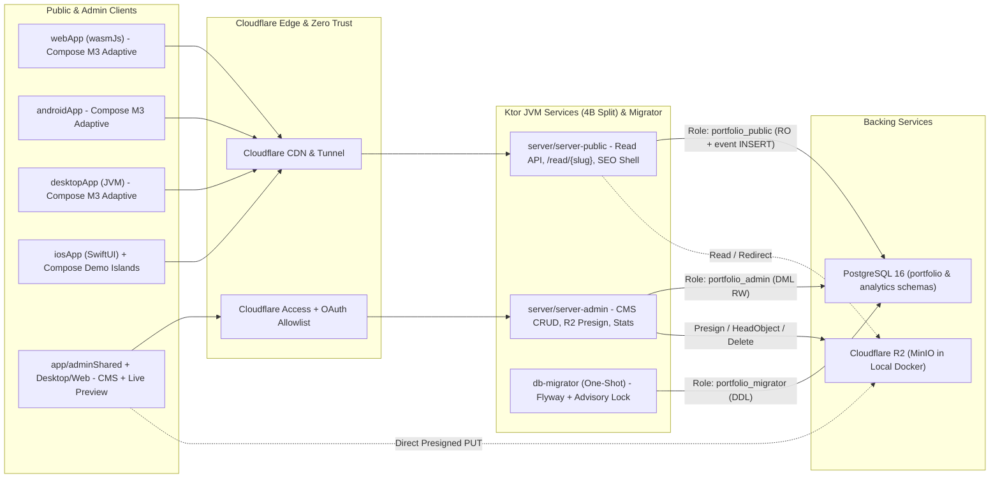
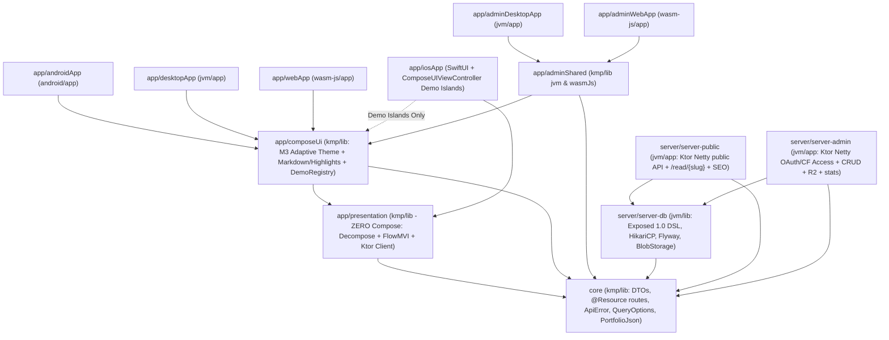
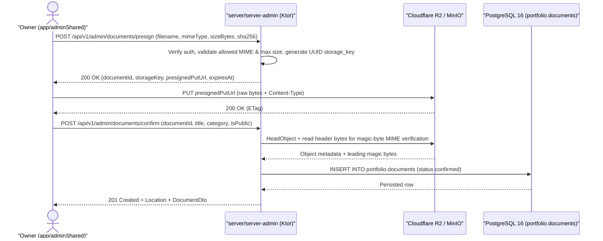
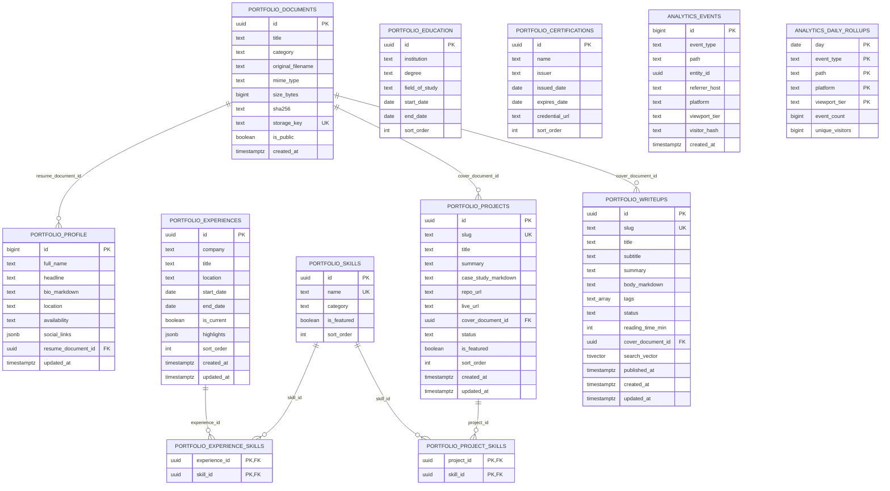

# Portfolio — Master Architecture Plan & Phase Tracker

> **Maintenance Rule:** Update this tracker whenever a phase or milestone finishes: check off completed `- [ ]` tasks, update the **Status** (`Not Started` -> `In Progress` -> `Done`) and **Completed Date** columns in the dashboard below, and record any architectural refinements in [architecture-decisions.md](architecture-decisions.md) before modifying code. Every file and rule must follow [CODING_STANDARDS.md](../CODING_STANDARDS.md).

---

## Phase Progress Dashboard

| Phase | Scope | Status | Key Verification Gate | Completed Date |
| :--- | :--- | :--- | :--- | :--- |
| **Phase 1** | Tooling, Standards, Docker, 4B Module Scaffold, `//core` & `//server/server-db` | Done | `compose.yaml` (`deps`) healthy, Flyway + `01_schema_structure_tests.sql` pass, `./kotlin build` passes | 2026-11-20 |
| **Phase 2** | Ktor `server/server-public` & `server/server-admin`, Dockerfiles, Testcontainers, Konsist, Bruno | Done | `./kotlin test`, Konsist boundaries, Testcontainers Postgres/MinIO tests, `./scripts/smoke.sh local --bruno` pass | 2026-11-20 |
| **Phase 3** | Pure KMP Presentation Layer (`//app/presentation` — Decompose + FlowMVI) | Done | FlowMVI store unit tests + Konsist compose-free guard pass across all KMP targets | 2026-11-20 |
| **Phase 4** | Public Compose UI (`//app/composeUi`, Android, Desktop, `wasmJs`) | Done | Adaptive resize checks (`Compact`/`Medium`/`Expanded`/`Large`/`Extra-Large`), `Highlights` + `DemoRegistry`, `wasmJs` URL history verified | 2026-11-21 |
| **Phase 5** | Native SwiftUI iOS (`//app/iosApp`) + Embedded Compose Demo Islands | Done | Xcode iOS build + SwiftUI `TabView`/`NavigationSplitView` + inline `ComposeUIViewController` demo verified | 2026-11-21 |
| **Phase 6** | Admin Compose UI (`//app/adminShared`, `//app/adminDesktopApp`, `//app/adminWebApp`) + Full E2E Smoke | Done | Admin stats, CMS CRUD, live Markdown/demo preview, R2 presigned upload, full `./scripts/smoke.sh local --bruno` pass | 2026-11-21 |

---

## Locked-In Decisions Summary

| Area | Locked-In Choice | Rationale & Rules |
| :--- | :--- | :--- |
| **Coding Standards** | Functional-first, `val` immutability, CQS, zero magic numbers, extension helpers | [CODING_STANDARDS.md](../CODING_STANDARDS.md) · [ADR 1](architecture-decisions.md#adr-1-universal-coding-standards-functional-core-immutability-cqs-zero-magic-numbers) |
| **Adaptive Public UI** | Option A — Material 3 Adaptive (`dp` breakpoints + modality + custom theme) on `wasmJs`, Android, Desktop | [ADR 2](architecture-decisions.md#adr-2-adaptive-ui-strategy-material-3-adaptive-dp-breakpoints-modality-and-custom-theme) |
| **iOS UI** | Native SwiftUI (`TabView`, `NavigationSplitView`) + occasional `ComposeUIViewController` demo islands | [ADR 3](architecture-decisions.md#adr-3-native-swiftui-on-ios-with-embedded-compose-demo-islands) |
| **Presentation & Routing** | Decompose (`ChildStack`, `ChildPanels`, `WebHistoryController`) + FlowMVI in Compose-free `app/presentation` | [ADR 4](architecture-decisions.md#adr-4-presentation-and-navigation-decompose-and-flowmvi-in-compose-free-apppresentation) |
| **Server & Admin Topology** | Topology 4B (Ktor JVM: `server/server-db`, `server/server-public`, `server/server-admin`) + separate `app/adminShared` UI | [ADR 5](architecture-decisions.md#adr-5-compile-time-split-ktor-jvm-servers-4b-and-separate-admin-ui) |
| **Database & Persistence** | PostgreSQL 16 (`portfolio`, `analytics`), Exposed 1.0 DSL-only + HikariCP, one-shot Flyway migrator, 3 DB roles | [ADR 6](architecture-decisions.md#adr-6-postgresql-16-exposed-10-dsl-only-one-shot-flyway-migrator-and-three-tier-roles) |
| **Error Contract** | Pure KMP `@Serializable sealed interface ApiError` in `//core` | [ADR 7](architecture-decisions.md#adr-7-pure-kmp-sealed-apierror-contract) |
| **Pagination & CQS** | `QueryOptions`/`PagedResult<T>` (CWE-190 guards), read-only `GET` downloads, deferred `ETag`/`If-Match` | [ADR 8](architecture-decisions.md#adr-8-stateless-pagination-pure-get-downloads-and-deferred-concurrency-tokens) |
| **Storage, Stats & SEO** | Cloudflare R2 presigned PUT (MinIO locally), cookieless analytics, `/read/{slug}` HTML Reader + Wasm SEO | [ADR 9](architecture-decisions.md#adr-9-cloudflare-r2-presigned-uploads-cookieless-analytics-and-ktor-readslug-seo) |
| **Containers & QA** | Multi-stage non-root Dockerfiles, profiled `compose.yaml`, Testcontainers, Konsist, Bruno (`bruno/`) | [ADR 10](architecture-decisions.md#adr-10-local-docker-emulation-testcontainers-konsist-fitness-functions-and-bruno-api-testing) |

---

## Architectural Diagrams

### 1. System & Deployment Topology

### 2. Module Dependency Graph

### 3. Cloudflare R2 Presigned Upload & Confirm Sequence

### 4. PostgreSQL Schema Entity-Relationship Diagram

---

## API & Route Contract Summary

### Public Surface (`server/server-public`)
- **Health Probes (unauthenticated):**
  - `GET /health` -> `200 OK` liveness check
  - `GET /health/ready` -> `200 OK` (verifies Postgres pool + Flyway schema readiness; `503` if unavailable)
- **Read APIs (`//core` `@Resource` contracts, `GET` only, zero writes):**
  - `GET /api/v1/public/portfolio` -> profile, experiences, education, certifications, featured skills
  - `GET /api/v1/public/projects` -> `PagedResult<ProjectSummaryDto>` (`QueryOptions`: `page`, `pageSize`, `sortBy`, `sortDirection`, `featured`, `skill`)
  - `GET /api/v1/public/projects/{slug}` -> `ProjectDetailDto`
  - `GET /api/v1/public/writeups` -> `PagedResult<WriteupSummaryDto>` (`QueryOptions` + `tag`, `q` Postgres full-text search)
  - `GET /api/v1/public/writeups/{slug}` -> `WriteupDetailDto`
  - `GET /api/v1/public/documents/{id}/download` -> read-only stream or signed redirect with `X-Content-Type-Options: nosniff` and `Content-Disposition`
- **Cookieless Analytics Ingestion:**
  - `POST /api/v1/public/events` -> `202 Accepted` (`PAGE_VIEW`, `WRITEUP_READ`, `PROJECT_CLICK`, `DOCUMENT_DOWNLOAD`, `platform`, `viewportTier`, daily-salted `visitor_hash`)
- **SEO, Reader View & Wasm Shell:**
  - `GET /read/{slug}` -> Ktor HTML DSL semantic Reader View (`Article` JSON-LD, canonical link, native `Ctrl+F`, link to interactive Wasm demo view)
  - `GET /sitemap.xml` and `GET /robots.txt`
  - SPA fallback serving `wasmJs` assets with Brotli/Gzip compression and dynamic per-route `<title>`, `<meta>`, `og:*`, JSON-LD, and `<noscript>` content

### Admin Surface (`server/server-admin` — Protected Unconditionally)
- **Health & Auth:**
  - `GET /health`, `GET /health/ready`
  - `GET /api/v1/admin/auth/session`, OAuth allowlist callbacks, Cloudflare Access `Cf-Access-Jwt-Assertion` validation, dev-profile HS256 token support (`scripts/dev-token.sh`)
- **Career, Projects & Writeups CRUD (`POST` -> `201` + `Location`, `PUT` -> `200`/`404`, `DELETE` -> `204`/`404`):**
  - `PUT /api/v1/admin/profile`
  - `/api/v1/admin/experiences`, `/education`, `/certifications`, `/skills`
  - `/api/v1/admin/projects`, `/api/v1/admin/projects/{id}`
  - `/api/v1/admin/writeups`, `/api/v1/admin/writeups/{id}` (draft, publish, archive)
- **Documents (Cloudflare R2 / MinIO):**
  - `GET /api/v1/admin/documents` -> `PagedResult<DocumentDto>`
  - `POST /api/v1/admin/documents/presign` -> presigned PUT URL
  - `POST /api/v1/admin/documents/confirm` -> verifies object + magic-byte MIME, inserts DB row (`201`)
  - `DELETE /api/v1/admin/documents/{id}` -> removes DB metadata + R2 object (`204`)
- **Analytics Overview:**
  - `GET /api/v1/admin/stats/overview?range=7d|30d|90d|all` -> total views, unique daily hashes, top writeups/projects, document downloads, referrer hosts, platform & viewport-tier breakdowns

### Pure KMP `ApiError` HTTP Status Mapping

| `ApiError` Variant (`//core`) | HTTP Status | Trigger Conditions |
| :--- | :--- | :--- |
| `ApiError.ValidationError` | `400 Bad Request` | Invalid query params, `pageSize` / `page` overflow (CWE-190), field validation errors, disallowed MIME/file size |
| `ApiError.Unauthorized` | `401 Unauthorized` | Missing, expired, or invalid admin session / JWT / Cloudflare Access token |
| `ApiError.Forbidden` | `403 Forbidden` | Authenticated user not on owner allowlist |
| `ApiError.NotFound` | `404 Not Found` | Unknown route, missing entity ID, or unpublished/missing slug |
| `ApiError.Conflict` | `409 Conflict` | PostgreSQL `23505` unique key violation (e.g., duplicate slug) or `23503` FK violation |
| `ApiError.InternalError` | `500 Internal Server Error` | Unhandled server/DB failure (message sanitized with `traceId` outside `dev`/`development`) |

---

## Detailed Phased Execution Checklist

### Phase 1 — Tooling, Standards Enforcement, Docker & DB Foundation
- [x] Add `.editorconfig`, `.githooks/pre-commit`, `.githooks/install-hooks.sh`, and `.env.example` (with `.env` ignored in `.gitignore`).
- [x] Create `compose.yaml` with profiles (`deps`: PostgreSQL 16 + one-shot `db-migrator` + MinIO; `local`: full stack with `server/server-public` & `server/server-admin`; `test`: ephemeral suite) and `127.0.0.1` port bindings.
- [x] Create `scripts/lib.sh`, `scripts/up.sh`, `scripts/down.sh`, `scripts/dev-token.sh`, and `scripts/smoke.sh` (`set -euo pipefail`, `readonly`, `shfmt -i 4`).
- [x] Restructure `project.yaml` and `libs.versions.toml` for the 4B topology (`core`, `app/presentation`, `app/composeUi`, `app/androidApp`, `app/desktopApp`, `app/webApp`, `app/iosApp`, `app/adminShared`, `app/adminDesktopApp`, `app/adminWebApp`, `server/server-db`, `server/server-public`, `server/server-admin`).
- [x] Implement `//core`: immutable `@Serializable` DTOs, Ktor `@Resource` contracts, `QueryOptions` & `PagedResult<T>` (with overflow bounds), `ApiError` sealed hierarchy, `PortfolioJson`, and unit tests.
- [x] Implement `//server/server-db`: Flyway `migrations/V1__init_schemas_roles_and_tables.sql` (`portfolio`, `analytics`, 3 DB roles, FK indexes, `TIMESTAMPTZ`, `tsvector` GIN index), `R__portfolio_read_views.sql`, `scripts/01_seed_dev_data.sql` (`generate_series`), `tests/01_schema_structure_tests.sql`, HikariCP factory, Exposed 1.0 DSL repositories, and `BlobStorage` (R2/MinIO).
- [x] Verify Phase 1 gates: `compose.yaml` (`deps`) healthy (`pgsty/minio` + `pgsty/mc`), Flyway + seed + `01_schema_structure_tests.sql` pass, `./kotlin build` (394/394 tasks) and `./kotlin test` (47 passed) succeed.

### Phase 2 — Ktor Public & Admin Servers, Dockerfiles, Testcontainers, Konsist & Bruno
- [x] Implement `server/server-public` clean layers (`domain`, `application`, `infrastructure`, `api`): `/health`, `/health/ready`, read APIs, `POST /api/v1/public/events`, pure `GET /documents/{id}/download`, `/read/{slug}` Ktor HTML DSL Reader View, `/sitemap.xml`, `/robots.txt`, dynamic Wasm SEO shell, Brotli/Gzip compression, and `StatusPages` -> `ApiError`.
- [x] Implement `server/server-admin` clean layers: `/health`, `/health/ready`, OAuth allowlist + Cloudflare Access JWT + dev-token auth, `*CommandService`/`*QueryService` CRUD routes, R2 presign + magic-byte MIME confirm + delete, analytics overview rollup queries, and `StatusPages` -> `ApiError`.
- [x] Add multi-stage non-root `Dockerfile`s (`server/server-public`, `server/server-admin`, `db-migrator`) and `.dockerignore`.
- [x] Add Ktor `testHost` contract tests, Testcontainers Postgres 16 + MinIO integration tests (verifying 3-tier DB permissions and `409` SQLState mappings), and Konsist architecture boundary tests.
- [x] Create full `bruno/` API collection (`00-Health`, `01-Public-Portfolio`, `02-Public-Writeups-And-SEO`, `03-Admin-CMS`, `04-Admin-Documents-And-Stats`, `05-Negative-Tests`) using environment variables and wire into `scripts/smoke.sh --bruno`.
- [x] Verify Phase 2 gates: `./kotlin test`, Konsist tests, Docker integration tests, and `./scripts/smoke.sh local --bruno` pass.

### Phase 3 — Pure KMP Presentation Layer (`//app/presentation`)
- [x] Configure `//app/presentation/module.yaml` with zero Compose dependencies.
- [x] Implement Ktor Client API services using `//core` `@Resource` routes, `PortfolioJson`, and exhaustive `ApiError` decoding.
- [x] Implement Decompose root/child components (`ChildStack` + `ChildPanels` adaptive scenes + deep-link route models for `WebHistoryController`).
- [x] Implement FlowMVI stores + Essenty integration (`ProfileStore`, `ProjectsStore`, `WriteupsStore`, `ReadArticleStore`, `ResumeDocsStore`) plus analytics/error/logging plugins.
- [x] Verify Phase 3 gates: FlowMVI unit tests and Konsist rule (`app/presentation` imports zero Compose symbols) pass.

### Phase 4 — Public Compose UI (`//app/composeUi`, Android, Desktop, `wasmJs`)
- [x] Build custom editorial portfolio design system over Material 3 Adaptive (`currentWindowAdaptiveInfo(supportLargeAndXLargeWidth = true)` across `Compact`, `Medium`, `Expanded`, `Large`, `Extra-Large` + input-modality polish).
- [x] Implement all visitor screens (Home/Bio, Experience/Education/Certs/Skills, Projects list-detail, Writeups list-detail/reader, Resume & Documents download via pure `GET` + analytics event).
- [x] Integrate `multiplatform-markdown-renderer` + `Highlights` syntax highlighting + `DemoRegistry` (`demo:<id>` fenced blocks with interactive Compose demos).
- [x] Wire `//app/webApp` `wasmJs` entry point with Decompose `WebHistoryController` browser URL + Back/Forward synchronization, and verify `//app/desktopApp` resizable window and `//app/androidApp`.
- [x] Verify Phase 4 gates: smooth live resizing across all 5 breakpoints, `wasmJs` URL navigation & SEO shell check, and Android/Desktop/Web builds pass.

### Phase 5 — Native SwiftUI iOS (`//app/iosApp`)
- [x] Expose Decompose `RootComponent` + `Value<State>` cleanly to Swift (`@StateValue` / `StackView` wrappers).
- [x] Implement native SwiftUI visitor screens (`TabView` on iPhone `compact`, `NavigationSplitView` on iPad `regular`) matching `//app/presentation` state.
- [x] Implement native Swift Markdown + code syntax highlighting and embed occasional `demo:<id>` interactive Compose demos via `ComposeUIViewController` + `UIViewControllerRepresentable`.
- [x] Verify Phase 5 gates: Xcode iOS simulator build passes and inline Compose demo islands render smoothly inside native SwiftUI writeups.

### Phase 6 — Admin Compose UI (`//app/adminShared`, `//app/adminDesktopApp`, `//app/adminWebApp`) & Full End-to-End Verification
- [x] Build `//app/adminShared`, `//app/adminDesktopApp`, and `//app/adminWebApp` (`wasmJs`) using Decompose + FlowMVI + Ktor Client.
- [x] Implement Admin Auth flow (OAuth / Cloudflare Access / local dev-token), Analytics Stats Dashboard (range filters, top writeups/projects, downloads, referrers, platform & viewport tiers), Career & Project CMS editors, Markdown Writeup editor with pixel-identical `//app/composeUi` + `DemoRegistry` live preview, and direct-to-R2 presigned document uploader.
- [x] Verify Phase 6 gates: full `compose.yaml` (`local` profile) startup, live admin publish -> public API -> `/read/{slug}` + `wasmJs` render, and full `./scripts/smoke.sh local --bruno` pass.
